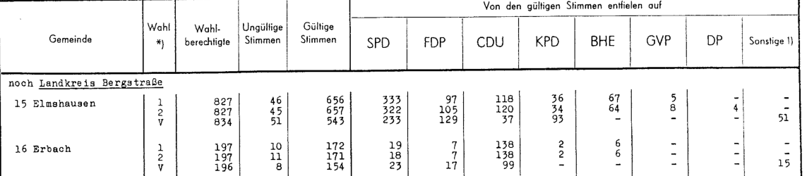

# Historical Election OCR

[](https://github.com/justus-dev02/OCR-ElectionData/actions/workflows/ci.yml) [](LICENSE)

**Verified extraction of 1949-1969 German election results from scanned statistical yearbooks.**

The pipeline reads municipal and constituency results of the Bundestag elections from the
printed volumes of the Statistisches Landesamt Baden-Württemberg (1949-1969) and the Hessian
statistical office (1953): about 1,000 table pages, 564,000 numeric cells. Every
value keeps its evidence (token crop, every engine's raw reading, every check). Nothing is
guessed: a value is accepted only when independent OCR engines agree **and** the printed
arithmetic of its row holds; everything else goes to a human review queue.

**No LLM or VLM is used anywhere in the extraction path** (see [D2](docs/decisions.md#d2---no-llm--vlm-in-the-extraction-path)).

> **Scope.** This repository is a first, self-contained part of a larger effort to digitise
> historical election data: the Bundestag elections 1949-1969 in Baden-Württemberg and
> Hessen 1953. The project is being extended continuously (further states, elections and
> administrative levels).

---

## Example: from scan to verified data

The source volumes are typewritten or line-printed tables of the official final results
(here: Hessen 1953, page 17 of the volume). Each municipality has three lines: `1` = first vote,
`2` = second vote, `V` = comparison figures of the 1949 election (read as a cross-check, never
published, see [D7](docs/decisions.md#d7---printed-shares-and-comparison-lines-are-cross-checks-never-published)).



What the pipeline extracted from these lines. Both rows passed every data check and are part of
the provisional export; every value is also **identical to the official file** used for the
external comparison:

| Municipality | Vote | Eligible | Invalid | Valid | SPD | FDP | CDU | KPD | BHE | GVP | DP | Others |
|---|---|---:|---:|---:|---:|---:|---:|---:|---:|---:|---:|---:|
| 15 Elmshausen | 1st | 827 | 46 | 656 | 333 | 97 | 118 | 36 | 67 | 5 | 0 | 0 |
| 15 Elmshausen | 2nd | 827 | 45 | 657 | 322 | 105 | 120 | 34 | 64 | 8 | 4 | 0 |
| 16 Erbach | 1st | 197 | 10 | 172 | 19 | 7 | 138 | 2 | 6 | 0 | 0 | 0 |
| 16 Erbach | 2nd | 197 | 11 | 171 | 18 | 7 | 138 | 2 | 6 | 0 | 0 | 0 |

Printed dashes become 0. The municipality *name* is still stored as the raw engine readings
(`tesseract: Elmshausen | easyocr: Slmhausen`) because names are only resolved against a
historical municipality register, which is not part of the repository yet.

More rows, with every column of the export (status, validation tier, source page, name readings,
run and result id): [`docs/examples/`](docs/examples/) - Hessen 1953 and the 1961 constituency
results of Baden-Württemberg.

### Per volume

| Volume | Table pages | Numeric cells | Agreed by ≥ 2 OCR engines | Result rows | Rows passing every data check |
|---|---:|---:|---:|---:|---:|
| Baden-Württemberg 1949 | 80 | 34,553 | 85.9 % | 3,425 | 638 |
| Baden-Württemberg 1953 | 82 | 88,494 | 93.2 % | 6,944 | 3,106 |
| Baden-Württemberg 1957 | 81 | 85,431 | 92.0 % | 6,976 | 2,719 |
| Baden-Württemberg 1961 | 102 | 73,587 | 87.6 % | 6,864 | 1,296 |
| Baden-Württemberg 1965 (line printer) | 276 | 95,808 | 82.3 % | 5,640 | 299 |
| Baden-Württemberg 1969 (line printer) | 258 | 107,870 | 67.2 % | 6,424 | 66 |
| Hessen 1953 | 128 | 78,444 | 91.8 % | 4,674 | 767 |

The share of fully verified rows falls with print quality: the 1965/1969 volumes are rule-less
line-printer output with faint glyphs, where a single unreadable cell blocks the whole row.

---

## Results

<!-- RESULTS:START -->
Full corpus run on 2026-10-12 (7 volumes, 1,007 table pages or page spreads, 0 page failures):

| Measure | Value |
|---|---|
| Numeric cells extracted | **564,187** |
| Cells on which ≥ 2 independent OCR engines agree (no dissent) | **84.8 %** (67 % for the 1969 line-printer tables, 92-93 % for 1953/1957) |
| Result rows (municipality/constituency x vote type) | 40,947 |
| Rows that pass **every** data check (all fields agreed, all row arithmetic executed and satisfied) | **8,891 (21.7 %)** - exported as *unpublished* provisional data |
| Rows that need a human (OCR dissent, structure, arithmetic, ...) | 32,056 |
| External check, Hessen 1953: machine-agreed cells equal to the official values | **18,001 / 18,027 (99.86 %)** |
| External check, Hessen 1953: cells of rows passing all data checks equal to the official values | **7,094 / 7,095** - the one difference is an impossible *negative* value (-4) in the official file |
| Wall time, 5 worker processes, Apple M3 Pro, 11 cores | 101 min (6.0 s per page) |
| Parallel speed-up, same volume (1961, 102 pages) | sequential 12.8 s/page → 5 workers 6.1 s/page (**2.1×**); 9 workers 7.2 s/page (no further gain: every worker holds its own OCR/ML models and CPU threads are split) |

Printed section totals could not yet be confirmed (0 of 679): every county contains at least one
row that still needs review, and the sum check needs all of its members. This is the next
lever for automation (see "Status and limitations").
<!-- RESULTS:END -->

Full numbers per document, per field and every external mismatch: [`reports/validation_report.md`](reports/validation_report.md).

### What the external comparison shows

The official Hessian 1953 municipality file (keyed independently by the statistical office) was
matched to the extracted rows **by name and county only**, never by the numbers being checked:

* Cells on which two OCR engines agree are already almost always right, but not always:
  the remaining differences are **faint or broken digits lost before OCR** ("373" printed with a
  faint last digit read as "37", a broken "0" in "50", the digit group "765" of "1 765" split
  off). Both engines read the same crop, so they agree on the truncated number - engine
  agreement alone is not independence.
* Exactly these rows fail the **row arithmetic** (party sum = valid votes, valid + invalid <=
  eligible). Rows that pass all data checks agree with the official values in every compared
  cell; the only difference found is an impossible negative value (-4 invalid votes) in the
  official file.
* One municipality ("Maberzell", page 96) differs in four parties because the official file has
  its values shifted by one column; the scan matches the pipeline.

The mismatches were inspected on the page images; see the report for the full list.

The Baden-Württemberg municipality data of the same source (GENESIS export, today's boundaries)
is **not** used: its sums over all municipalities differ from the printed state totals (postal
votes from 1957 on are not assigned to municipalities; 1953 differs by up to 72 votes per party).
The printed totals were checked on the scans and match the pipeline (e.g. FDP 1953: 502,041).

---

## How it works

```
PDF ─sha256─► registry ─► document profile (bound to that sha256, otherwise refuse)
                              │
   parallel workers           ▼  per page / page spread
   ┌──────────────────────────────────────────────────────────────────────────┐
   │ render 300 dpi + deskew                                                  │
   │ table region + header end ........ rules / page ink / printed col. numbers│
   │ column partition .................. 2 deterministic evidences (D4)         │
   │ glyph tokens + anchor lines ....... connected components, no OCR          │
   │ header verification ............... header text / column numbers ⇄ profile│
   │ OCR per token ..................... Tesseract 5 │ EasyOCR │ PDF text layer │
   └──────────────────────────────────────────────────────────────────────────┘
   main process, page order           ▼
   line groups, roles, sections (context carried across pages), number formats per slot
                              ▼
   validation: cell agreement (D1) · row arithmetic · definition probes (D8) · printed shares
   (D7) · section and state sums · duplicates · entity resolution · reference data (D10)
        ├── blocking issue ──► review case (CLI, image crops, candidate readings) ──┐
        └── none ─────────────► publication gate (re-checks everything) ─► published ◄┘
```

* Architecture, module map and data model: [`docs/architecture.md`](docs/architecture.md)
* Design decisions with their evidence (why no majority vote, why TATR is evidence only, ...):
  [`docs/decisions.md`](docs/decisions.md)

### Engineering highlights

* **Evidence-first data model** (SQLAlchemy 2.0, typed): pages → tables → cells → OCR
  candidates → result rows → issues; status changes only through a state machine; published
  values carry full provenance (run, config fingerprint, reference snapshot, engine versions,
  page image hash, cell id).
* **Machine-readable reasons**: every non-published value has `IssueCode`s; the review queue can
  be filtered by code, and error frequencies are measured instead of logged.
* **Domain knowledge as data**: 7 document profiles (YAML, pydantic-validated, bound by SHA-256)
  describe 11 table layouts (ruled, header-ruled, rule-less line-printer, page spreads).
* **Parallel extraction** in worker processes, sequential interpretation in page order
  ([D12](docs/decisions.md#d12---parallel-extraction-sequential-interpretation)): 2.1× faster;
  a full volume (1961, ~500,000 stored records) is identical with 1 and with 9 workers.
* **Golden-master regression**: `scripts/regression_snapshot.py` dumps everything a run stores for
  11 sample cases (all layouts, ~150,000 records) and diffs two captures. The refactoring and
  the parallel execution model were verified to be **byte-identical** to the previous sequential
  implementation; the pipeline is deterministic (repeated runs are identical).
* **Quality gates**: 131 fast tests (no models needed) + 8 slow real-page tests, `ruff`
  (lint + format), `mypy` on the whole package, GitHub Actions CI.

---

## Status and limitations

* **Nothing is published yet - by design.** Publication requires a historical municipality
  register (gazetteer) and a human check of the reference data (`verified: true`). Until then,
  machine-verified rows are available as an explicitly **unpublished** provisional export
  (`election-ocr export provisional`), and their quality is measured by the validation report.
* **No hand-made gold standard yet.** The external comparison above is the independent
  accuracy measurement; a signed gold set (`gold/`, `election-ocr evaluate`) is still to do.
* **One profile per document.** A new volume needs a YAML profile (200-480 lines so far). This
  keeps every assumption reviewable but is the main scaling cost.
* **Line-printer tables (1965/1969) are hard**: lower engine agreement, unreadable headers on
  some pages (those pages stay blocked instead of being guessed).
* **Shared crops are a shared failure mode**: a faint digit lost during segmentation is lost for
  every engine. Row arithmetic catches it; a dedicated check for "ink next to a number that no
  token owns" would catch it earlier.
* The EasyOCR model fine-tuned on number tokens is available but not enabled
  ([D11](docs/decisions.md#d11---ocr-fine-tuning-evaluated-not-enabled-by-default)).

---

## Quickstart

Requirements: Python 3.12+, Tesseract 5 with German data (`brew install tesseract tesseract-lang`
or `apt install tesseract-ocr tesseract-ocr-deu libtesseract-dev`).

```bash
python -m venv .venv && .venv/bin/pip install -e ".[dev]"
.venv/bin/pytest                      # fast tests, no models needed
election-ocr reference check          # load and cross-validate the reference data
```

or with Docker:

```bash
docker build -t election-ocr .
docker run --rm election-ocr pytest -q
```

### Reproducing the results

The source scans are not redistributed (see "Data"). With the PDFs in `data/`:

```bash
election-ocr run data/080_2611_61001.pdf --workers 5      # one volume (models download on first use)
python scripts/run_corpus.py --workers 5                  # every profiled volume, with timing
scripts/fetch_gpwed.sh                                    # official comparison data (pinned commit)
election-ocr report validation                            # -> reports/validation_report.{md,json}
election-ocr export provisional                           # -> output/exports/provisional/*.csv
python scripts/regression_snapshot.py capture --out .work/a --workers 4   # golden master
```

### CLI overview

```bash
election-ocr runs                                          # processing runs
election-ocr review list --code OCR_ENGINE_DISAGREEMENT    # review queue, filtered by reason
election-ocr review show 12                                # readings, issues, image crops
election-ocr review set 12 party:spd 163 --reviewer "J.S." --reason "read on the scan"
election-ocr review approve 12 --reviewer "J.S." --reason "checked"
election-ocr validate --run <RUN_ID>                       # re-validate after reference changes
election-ocr export published --format all                 # JSON, Markdown, CSV, Parquet
election-ocr gold template --run <RUN_ID> --page 120       # gold transcription skeleton
election-ocr evaluate --run <RUN_ID>                       # false-accept rate against gold
election-ocr train easyocr --db ... --crops ...            # optional OCR fine-tuning
```

---

## Data

| Source | Use | Redistributed? |
|---|---|---|
| Statistik von Baden-Württemberg, vol. 10, 11, 43, 80, 121, 166 (Bundestag elections 1949-1969) | extracted | no (scans stay local, `data/` is git-ignored) |
| Beiträge zur Statistik Hessens no. 64 (Bundestag election 1953) | extracted | no |
| [GPWED](https://github.com/julian-voss/gpwed) state files (`scripts/fetch_gpwed.sh`, pinned commit) | external validation only | no (the repository has no licence) |

The volumes contain the official final results published by the statistical offices; the
excerpt above is reproduced with source attribution.

## Project layout

```
config/pipeline.yaml        technical settings (no domain data)
reference/                  domain reference data: parties, elections, document profiles, gazetteer
src/election_ocr/           the package (see docs/architecture.md)
tests/                      unit + integration tests; -m slow: real pages (needs data/ and models/)
scripts/                    corpus run, golden-master regression, external data download
reports/                    generated validation report
docs/                       architecture and design decisions
```

## Roadmap

This is an early, deliberately narrow part of a longer project; it is extended step by step:

* hand-labelled gold set and evaluation of the fine-tuned / self-trained number recogniser
* historical municipality register, human verification of the reference data, first publication
* further states and elections (1972 onwards) and further administrative levels

## License

Code and reference data: [Apache License 2.0](LICENSE). The scanned source volumes are not part
of the repository.
