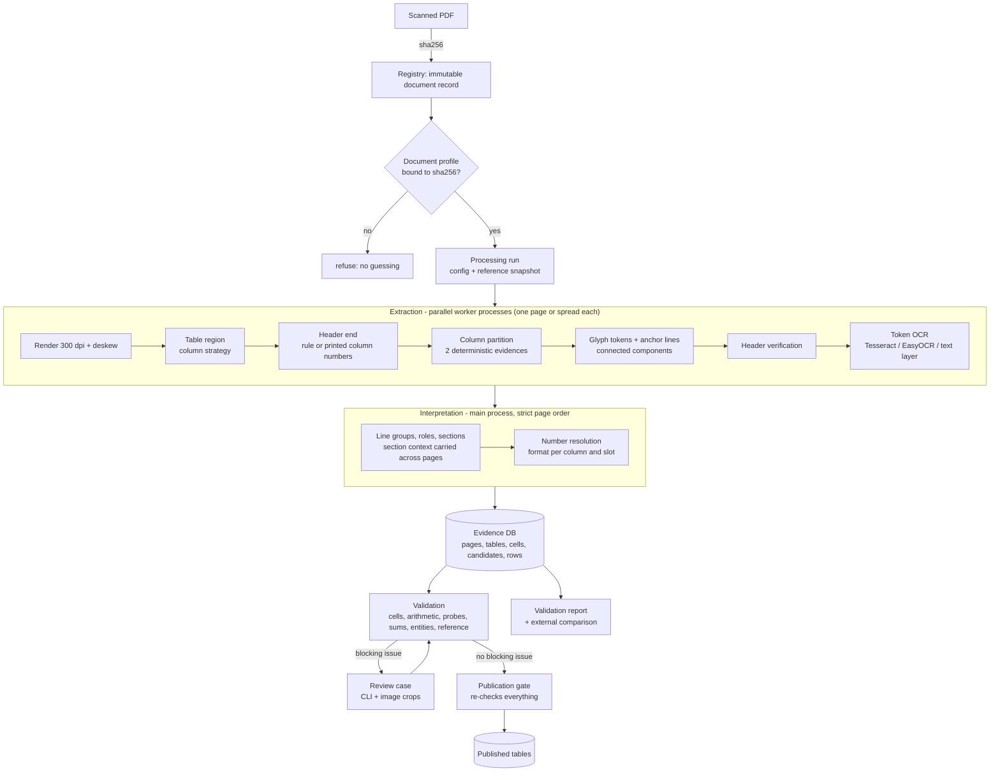

# Architecture

## Data flow

## Modules

| Package | Responsibility | Key modules |
|---|---|---|
| `ingestion` | SHA-256 registry, rendering + deskew | `registry.py`, `render.py` |
| `preprocessing` | ink masks, ruling-line separation, skew estimation | `image_ops.py` |
| `layout` | table region, column strategies, ruling lines, glyph tokens, TATR wrapper | `column_strategies.py`, `table_structure.py`, `structure.py`, `tokens.py`, `tatr.py` |
| `ocr` | engines (Strategy pattern), token crops, candidate resolver | `engines.py`, `token_reader.py`, `resolver.py` |
| `parsing` | strict number grammar, text normalisation | `numbers.py`, `text.py` |
| `semantics` | header verification, label classification, rows/sections, entity resolution | `header.py`, `labels.py`, `rows.py`, `entities.py` |
| `pipeline` | runner (parallel extraction), page processor, extraction, interpretation, validation service, state machine | `runner.py`, `page_processor.py`, `extraction.py`, `interpretation.py`, `document_service.py` |
| `validation` | deterministic rule families, definition probes | `rules.py` |
| `persistence` | SQLAlchemy 2.0 schema (typed), repository | `db.py`, `repository.py` |
| `review` | human-in-the-loop decisions (never overwrite evidence) | `service.py` |
| `exports` | evidence JSON, published data (JSON/MD/CSV/Parquet), provisional CSV | `writers.py`, `provisional.py` |
| `evaluation` | gold standard, validation report, external comparison | `gold.py`, `validation_report.py`, `external.py` |
| `training` | OCR fine-tuning labels, Tesseract / EasyOCR trainers | `labels.py`, `tesseract.py`, `easyocr_ft.py` |
| `reference` | pydantic models + loader for `reference/` | `models.py`, `repository.py` |
| `cli` | `election-ocr` commands, one module per topic | `pipeline.py`, `review.py`, `export.py`, `report.py`, ... |

## Data model (logical layers)

| Layer | Tables | Written by | Mutable? |
|---|---|---|---|
| evidence | `source_documents`, `processing_runs`, `pages`, `tables`, `cells`, `ocr_candidates` | extraction | append-only per run |
| processing | `result_rows`, `issues`, `state_transitions` | interpretation, validation | status via state machine only |
| review | `review_cases`, `review_decisions`, `field_overrides`, `acknowledgements` | reviewers | append-only decisions |
| published | `published_results`, `published_party_results` | publication gate | superseded, never edited |

Analytics read only the published layer. Every published value carries its provenance:
run, config fingerprint, reference snapshot, engine versions, page image hash, cell id.

## Execution model

* **Extraction** (`PageWorker`) is a pure function of one page (or spread) and the profile, so
  `DocumentRunner` runs it in a `ProcessPoolExecutor` (`spawn` context; every worker loads its
  own Tesseract/EasyOCR/TATR once; CPU threads are split evenly between workers).
* **Interpretation** consumes the worker results in page order in the main process, because
  the section context (county, region) is carried from page to page.
* `scripts/regression_snapshot.py` captures a canonical dump of everything a run stores for
  eleven sample cases (all table layouts) and diffs two captures; refactorings and the
  parallel execution model were verified against it to be byte-identical.
